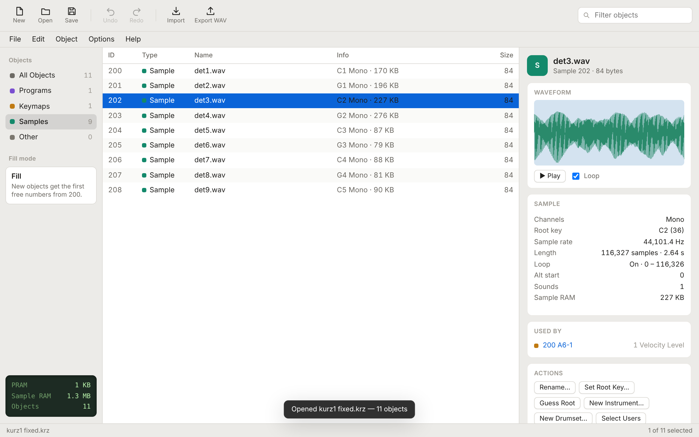
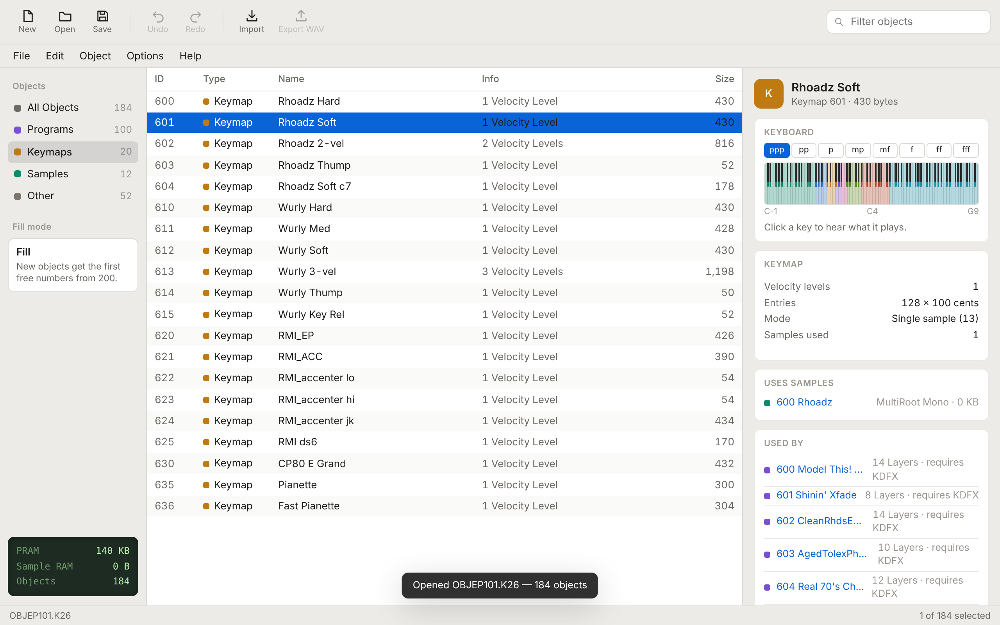
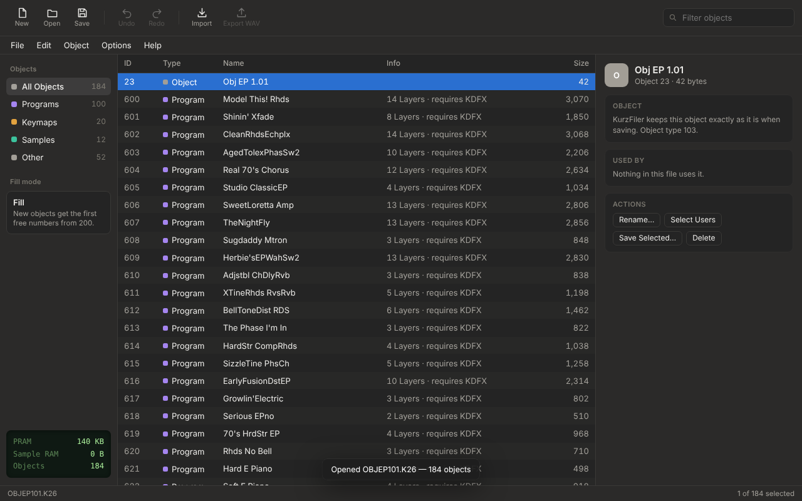

# KurzFiler for macOS

A modern, native Apple Silicon re-creation of **KurzFiler**, the classic file manager for **Kurzweil K2000, K2500 and K2600** instruments. It opens and saves `.krz`, `.k25` and `.k26` files, turns WAV/AIFF audio into K2000 samples, and builds programs and keymaps from them. No Java required.



## Features

Everything the original KurzFiler (1.1d / 1.2) does:

- Open, join and save Kurzweil files. **Save As** targets the K2000 (`.krz`), K2500 (`.k25`) or K2600 (`.k26`); newer program features are removed for older instruments.
- Import **WAV** (8/16/24-bit, float, mono/stereo, with loop and root from the `smpl` chunk), **AIFF/AIFF-C** and Amiga **IFF 8SVX** as samples.
- Export samples as WAV (with loop and root key).
- Rename, delete (optionally with unused dependants), unlimited undo/redo.
- **Set Root Key**, **Guess Root from Name**, **AltStart to SampleEnd**.
- **New Instrument** (chromatic keymap, gaps filled), **New Drumset**, **Velocity Split Keymap**.
- **Compact Keymap** (KCompact: combines a keymap's samples into one multi-root sample).
- **Select Dependants / Select Users**, **Save Selected**, **Remap IDs**, **File Information**.
- **Fill mode**: Fill (first free IDs from a start number, default 200), Append or Merge.

New in this version:

- Waveform view and playback (Space), and a playable keymap keyboard.
- Inspector showing how programs, keymaps and samples link together.
- Search filter, sortable columns, light and dark mode.
- Native Mac menus, file associations, Open Recent, drag and drop.

| Keymap view | Dark mode |
|---|---|
|  |  |

## Install

Download `KurzFiler-mac-arm64.zip` from the [Releases](../../releases) page, unzip it and drag **KurzFiler.app** to Applications.

The app is not notarized by Apple, so the first launch is blocked. Open **System Settings → Privacy & Security** and click **Open Anyway**. Alternatively, run:

```sh
xattr -dr com.apple.quarantine /Applications/KurzFiler.app
```

Requires an Apple Silicon Mac (M1 or later), macOS 12 or newer.

## How it is built

| Path | What |
|---|---|
| `app/krz-core.js` | The file-format library: parsing and writing K2x00 files, audio import/export, all object operations. No dependencies; runs in Node and the browser. |
| `app/index.html`, `app.js`, `app.css` | The user interface. It also runs in a plain browser (open `app/index.html`), with downloads instead of save dialogs. |
| `app/main.js`, `app/preload.js` | The Electron shell: window, native menus, file dialogs, file associations. |
| `build/package.py` | Assembles `KurzFiler.app` from the official Electron macOS arm64 runtime and ad-hoc signs it. |
| `build/make_icon.py` | Draws the app icon. |
| `test/` | Differential tests against the original KurzFiler, plus audio, UI and Electron tests. |

### Building the app

You need Python 3, `zip`/`unzip`, the Electron 39.2.7 `darwin-arm64` zip from the [Electron releases](https://github.com/electron/electron/releases/tag/v39.2.7), and [`rcodesign`](https://github.com/indygreg/apple-platform-rs) (works on macOS and Linux):

```sh
ELECTRON_ZIP=path/to/electron-v39.2.7-darwin-arm64.zip RCODESIGN=path/to/rcodesign python3 build/package.py
# -> dist/KurzFiler-mac-arm64.zip
```

To run from source during development, install Electron and run `electron app`.

### Tests

The core is checked against the original program. The test harness (`test/Ref.java`) drives the original KurzFiler classes headlessly, and `difftest.js` compares their output with this implementation, byte for byte where possible.

```sh
git clone https://github.com/SpotlightKid/kurzfiler test/.work/kurzfiler   # original sources + test files
cp path/to/KurzFiler.jar test/.work/KurzFiler.jar                           # original 1.1d jar
python3 test/make_audio.py
node test/difftest.js      # 63 checks against the original (needs a JDK)
node test/audiotest.js
python3 test/uitest.py     # needs Playwright
```

### Deliberate differences from the original

- **Opening a file keeps the instrument's object numbers.** The original renumbered everything from 200 in Fill mode.
- **Real envelope offsets in multi-root samples are kept.** The original rewrote them, which damaged K2600 samples.
- **Names longer than 16 characters from `.k26` files are kept.** They're only shortened when saving for the K2000.
- **Compact Keymap keeps object numbers and refuses to mix mono and stereo samples.** The original reused sample ID 1000 for every compaction.
- **Deleting with dependants only removes keymaps and samples that nothing else uses.**
- **Fill mode renumbers only programs, keymaps and samples.** Setups and studios keep their numbers.

## License and credits

Copyright © 2026 leonardolopezchavira.

This program is free software: you can redistribute it and/or modify it under the terms of the **GNU General Public License, version 3** or (at your option) any later version. See [LICENSE](LICENSE).

It is a derivative of [KurzFiler](https://github.com/SpotlightKid/kurzfiler) © 2001–2008 Marc Halbrügge and Sven Thoennissen, released under the GNU GPL version 2 or (at your option) any later version. That "or any later version" clause is what allows this version to be distributed under GPLv3.

Kurzweil, K2000, K2500 and K2600 are trademarks of their respective owners. This project is not affiliated with them.
